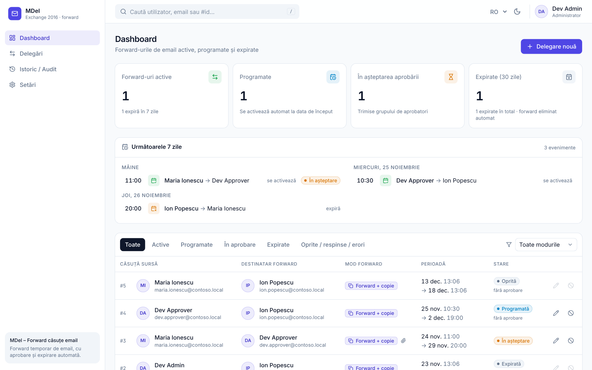
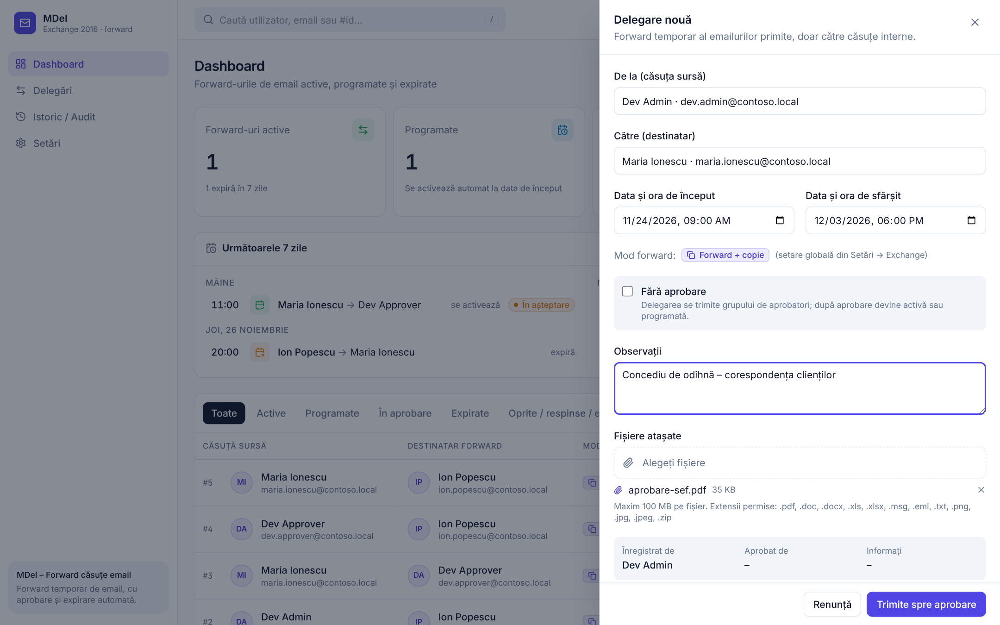
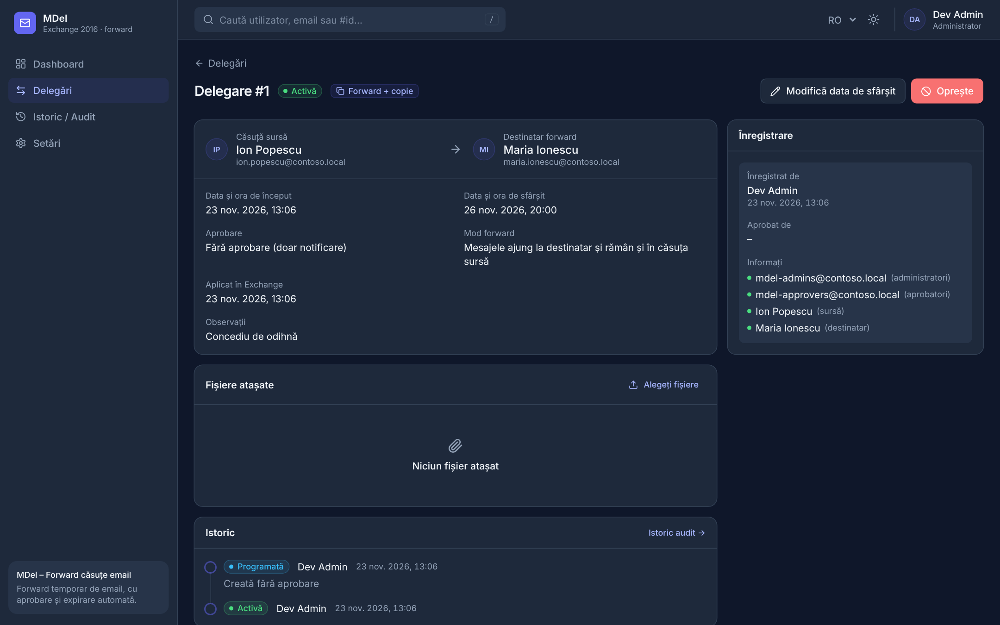
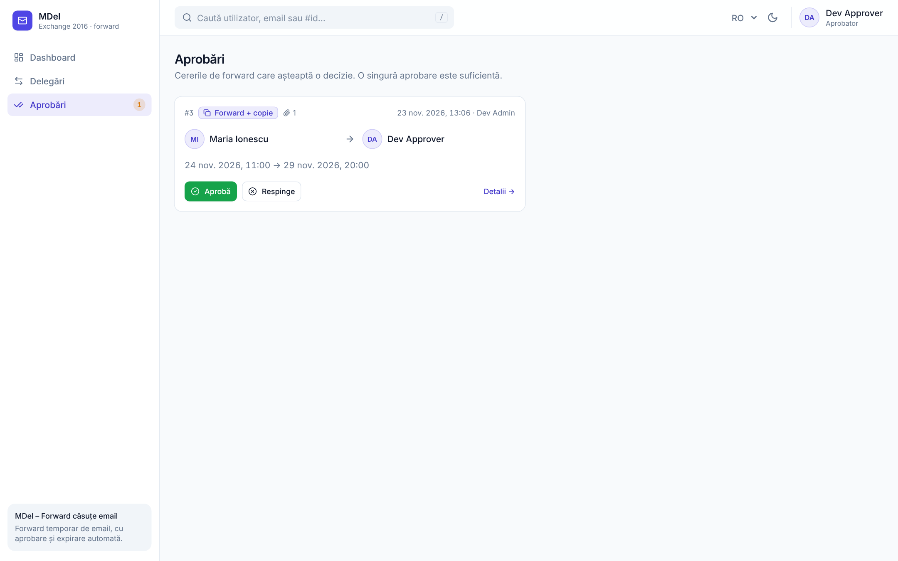
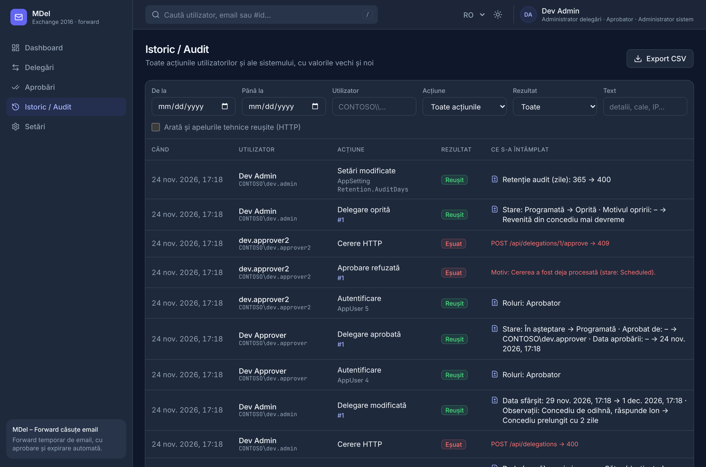
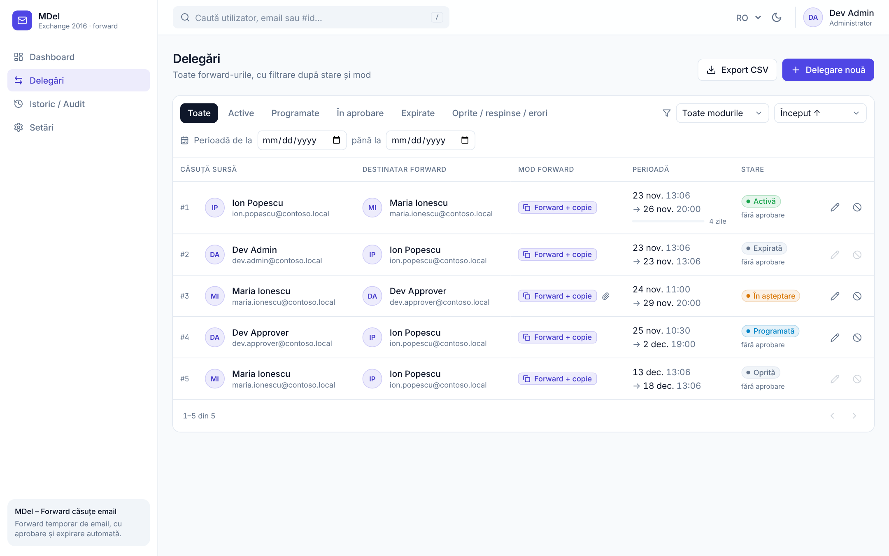
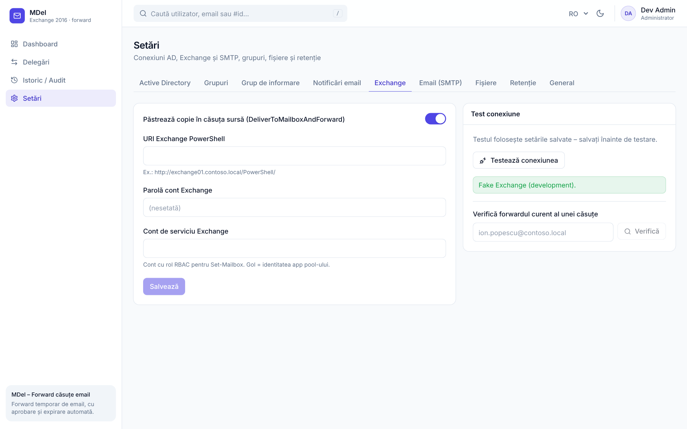
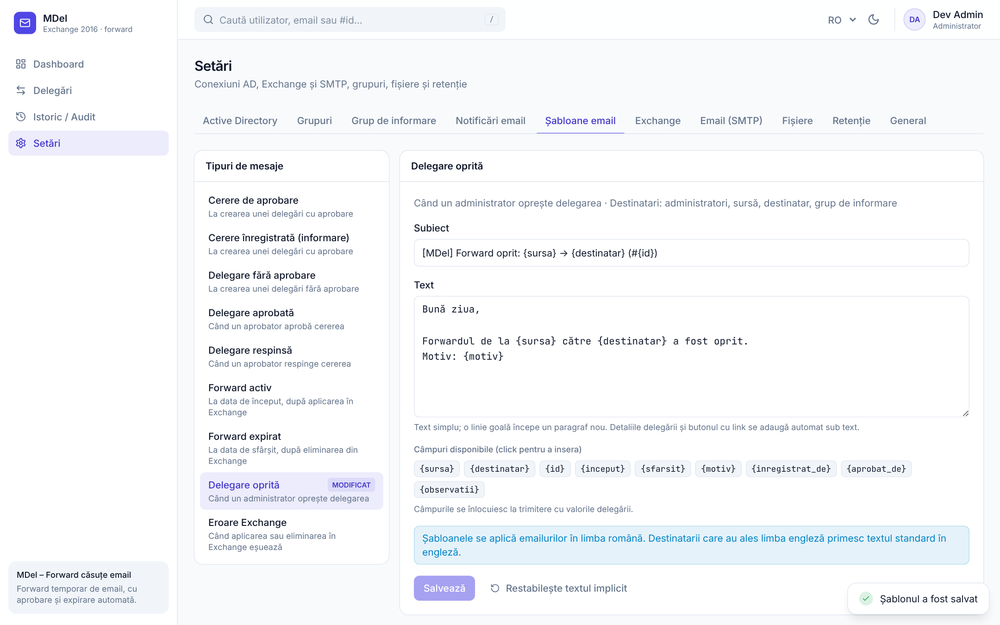
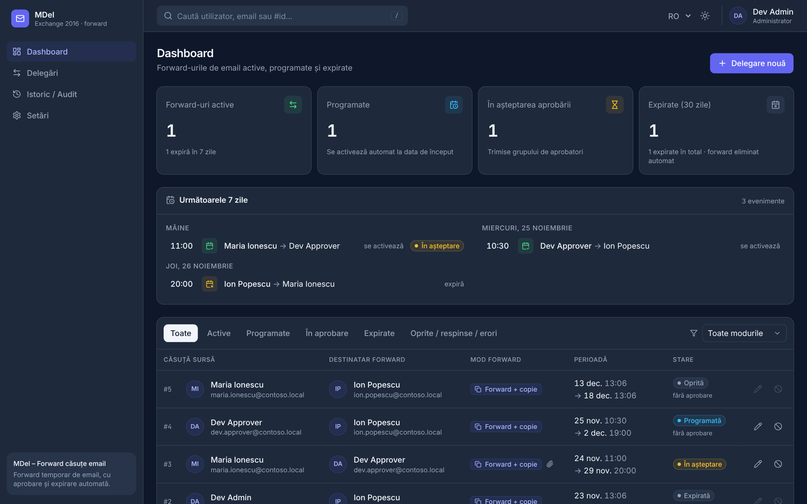
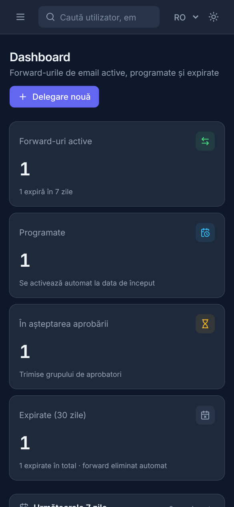

# MDel – forward de căsuțe email (Exchange 2016)

Aplicație prin care administratorii de sistem configurează forwardul de email
de pe căsuța unui utilizator către altul, cu aprobare, programare și expirare automată.
Planul complet: [PLAN.md](PLAN.md).

## Capturi de ecran

Date de exemplu, rulare locală (AD, Exchange și SMTP simulate).

**Dashboard** – carduri KPI, activările și expirările din următoarele 7 zile, ultimele delegări:



| Delegare nouă (panou lateral) | Detaliul unei delegări (dark) |
|---|---|
|  |  |
| **Aprobări** (grupul de aprobatori) | **Istoric / Audit** cu valori vechi/noi |
|  |  |
| **Delegări** – filtre, sortare, export CSV | **Setări → Exchange** cu test de conexiune |
|  |  |
| **Setări → Șabloane email** (română, cu previzualizare) | |
|  | |

<p>
  
  &nbsp;
  
</p>

## Structură

```
backend/                     ASP.NET Core (.NET 10)
  src/MDel.Domain            entități + enum-uri (fără atribute EF)
  src/MDel.Application       interfețe: IDirectoryService, IExchangeService, IMailService, IAuditService, ICurrentUser
  src/MDel.Infrastructure    EF Core (MDelDbContext + migrații), audit, setări, integrări AD/Exchange/SMTP
  src/MDel.Api               Web API, autentificare AD, middleware audit, servire SPA
  tests/MDel.Tests           xUnit (model EF, API, reguli, notificări, scheduler, audit)
frontend/                    React + TypeScript (Vite), Tailwind CSS, lucide-react, React Query, i18next (ro/en)
  e2e/                       teste end-to-end Playwright
scripts/                     obiecte AD, rol RBAC Exchange, smoke-test Exchange, publicare (Publish-MDel.ps1 / publish.sh)
offline/                     pachetele NuGet și npm pentru dezvoltare offline + scripturi de restaurare
docs/                        AD-SETUP.md (pregătire AD), DEPLOY.md (instalare IIS), UAT.md (checklist), capturi
```

## Baza de date (EF Core, code-first)

Tabelele, relațiile, indecșii, constrângerile și datele implicite sunt declarate în
`MDelDbContext.OnModelCreating` prin `ModelBuilder`
(`backend/src/MDel.Infrastructure/Persistence/MDelDbContext.cs`). Toate tabelele sunt în schema `mdel`.

| Tabelă | Relații |
|---|---|
| `AppUsers` | utilizatori AD (cache local) + limba preferată |
| `Delegations` | `FromUser`, `ToUser`, `CreatedBy`, `ApprovedBy`, `StoppedBy` → `AppUsers` (Restrict) |
| `DelegationAttachments` | → `Delegations` (Cascade), `UploadedBy` → `AppUsers` |
| `DelegationNotifications` | → `Delegations` (Cascade), `RecipientUser` → `AppUsers` |
| `DelegationStatusHistory` | → `Delegations` (Cascade), `ChangedBy` → `AppUsers` |
| `InformGroupMembers` | `User` → `AppUsers` (1 – 0..1, unic), `AddedBy` → `AppUsers` |
| `AppSettings` | `UpdatedBy` → `AppUsers`; valori implicite: retenție 365 zile, 100 MB etc. |
| `AuditLogs` | `User` → `AppUsers`; append-only |

Comenzile se rulează din `backend/`:

```bash
dotnet tool restore                      # instalează dotnet-ef (versiunea din dotnet-tools.json)

# după orice modificare a modelului:
dotnet ef migrations add <NumeMigrare> -p src/MDel.Infrastructure -s src/MDel.Api -o Persistence/Migrations

# creează / actualizează baza de date (connection string "MDel" din appsettings):
dotnet ef database update -p src/MDel.Infrastructure -s src/MDel.Api
```

`dotnet ef` citește connection string-ul `MDel` din `src/MDel.Api/appsettings.Development.json`
(sau `appsettings.{ASPNETCORE_ENVIRONMENT}.json`); variabila `MDEL_CONNECTION_STRING` are prioritate.

**La pornire, aplicația creează singură baza** în SQL Server (dacă nu există) și aplică migrările neaplicate
(`Setup:MigrateDatabaseOnStartup`, implicit `true`), deci pe un server nou nu e nevoie de `database update`.
Pentru un DBA care preferă să aplice el structura (`MigrateDatabaseOnStartup = false`) se poate genera scriptul
SQL idempotent:

```bash
dotnet ef migrations script --idempotent -p src/MDel.Infrastructure -s src/MDel.Api -o mdel.sql
```

## Rulare locală

Cerințe: .NET 10 SDK, Node 22, SQL Server.

1. Setați connection string-ul în `backend/src/MDel.Api/appsettings.Development.json`
   (sau cu `dotnet user-secrets set "ConnectionStrings:MDel" "..."`).
2. `cd backend && dotnet restore MDel.slnx && dotnet run --project src/MDel.Api` (http://localhost:5080) – la pornire
   se creează baza și se aplică migrările (sau manual: `dotnet tool restore && dotnet ef database update -p src/MDel.Infrastructure -s src/MDel.Api`)
3. `cd frontend && npm ci && npm run dev` (http://localhost:5173, proxy `/api` → 5080)

Pachetele NuGet și npm se iau din `offline/` (`backend/NuGet.config`, `frontend/.npmrc`), deci restore-ul merge și
fără internet. O dependență nouă se adaugă cu `offline/create-offline-bundle.sh` (vezi [offline/README.md](offline/README.md)).

În **Development**, autentificarea este simulată (`Authentication:Mode = Development`):
utilizatorul și grupurile AD vin din `appsettings.Development.json`, iar headerul `X-Dev-User`
și `X-Dev-Groups` (listă separată prin virgulă sau `none`) permit schimbarea utilizatorului și a grupurilor.
AD, Exchange și SMTP sunt înlocuite de implementări in-memory (`Integrations:UseFakes = true`).

Pentru a încerca interfața **fără SQL Server**: `Database__UseInMemory=true dotnet run --project src/MDel.Api`
(bază in-memory, doar în Development; datele se pierd la oprire). Setați apoi calea de fișiere în
Administrare → Fișiere.

## Integrări (producție)

| Sistem | Implementare | Configurare (Administrare) | Test |
|---|---|---|---|
| Active Directory | LDAP – `System.DirectoryServices.Protocols`, Negotiate cu sign & seal sau LDAPS | domeniu, server, Base DN, cont de serviciu | bind + citire Base DN |
| Exchange 2016 | PowerShell remoting (`/PowerShell/`, Kerberos) – `Get-Mailbox`, `Set-Mailbox`, `Get-Recipient` | URI, cont de serviciu, copie în sursă | `Get-Recipient -ResultSize 1` + citire forward |
| SMTP | MailKit | server, port, TLS, utilizator, expeditor | conectare + email de test opțional |
| Fișiere | disc local / share UNC | cale, limită MB, extensii | scriere/citire/ștergere fișier de probă |

- Parolele din setări sunt criptate cu ASP.NET Core Data Protection. Cheile se păstrează în
  `DataProtection:KeysPath` (implicit `C:\ProgramData\MDel\keys`, protejate cu DPAPI la nivel de mașină).
  Contul app pool-ului trebuie să aibă drept de scriere acolo. Dacă cheile se pierd, parolele trebuie reintroduse.
- Fără cont de serviciu completat, AD și Exchange folosesc identitatea app pool-ului (Kerberos).
- Contul pentru Exchange are nevoie de rolul RBAC creat cu `scripts/New-MDelRbacRole.ps1`.
- Forwardul acceptă doar destinatari interni (`UserMailbox`, `SharedMailbox`, `LinkedMailbox`).

## Aprobare și notificări

- O cerere cu aprobare ajunge pe emailul grupului de aprobatori (`Groups.ApproversEmail`). Un singur aprobator
  este suficient; al doilea primește „deja procesată”. Aprobarea propriei cereri e blocată de `General.PreventSelfApproval`.
- Cu bifa „Fără aprobare”, delegarea devine programată/activă imediat, iar aprobatorii sunt doar informați.
- Emailurile se pun într-o coadă (tabela `DelegationNotifications`) în aceeași tranzacție cu schimbarea de stare
  și sunt trimise de un serviciu de fundal, cu reîncercări (max. 5). Fiecare destinatar primește mesajul în limba lui.
- Destinatari: aprobatori, administratori (`Groups.AdminsEmail`), utilizatorul sursă, destinatarul și
  **grupul de informare** (utilizatori adăugați din Setări → Grup de informare).
- `General.BaseUrl` (Setări → General) adaugă în emailuri link direct către delegare.
- **Setări → Șabloane email**: subiectul și textul fiecărui tip de mesaj (cerere de aprobare, aprobată, respinsă,
  activă, expirată, oprită, eroare…), în **română**, cu câmpuri `{sursa}`, `{destinatar}`, `{id}`, `{inceput}`,
  `{sfarsit}`, `{motiv}`, `{inregistrat_de}`, `{aprobat_de}`, `{observatii}` și previzualizare. Detaliile delegării și
  butonul cu link se adaugă automat; textul se escapează (nu se poate injecta HTML). Un câmp golit revine la textul
  implicit. Destinatarii cu limba engleză primesc textul standard în engleză.

## Activare și expirare automată (etapa 4)

Un serviciu de fundal (`SchedulerHostedService`) rulează la fiecare `Scheduler:IntervalSeconds` (implicit 30 s):

| Situație | Acțiune |
|---|---|
| Programată, data de început atinsă | forward aplicat în Exchange → **Activă**, notificare către administratori, sursă, destinatar, grup de informare |
| Activă, data de sfârșit atinsă | forward eliminat și cel anterior restaurat → **Expirată**, notificare către aceiași destinatari |
| În aprobare / programată, sfârșit atins fără activare | → **Expirată**, fără operații în Exchange |
| Eroare Exchange | → **Eroare**, administratorii sunt anunțați o dată; reîncercare la fiecare 10 minute |

- Reconcilierea (`Scheduler:ReconcileMinutes`, implicit 60) verifică în Exchange că forwardurile active sunt încă
  cele aplicate de aplicație; o modificare manuală apare ca avertisment pe delegare, în audit și pe email la administratori.
- Retenția rulează zilnic: fișierele și înregistrările de audit mai vechi decât perioada setată (implicit 365 de zile) se șterg.
- Starea e în baza de date: după un restart, tot ce a devenit scadent între timp se procesează la prima rulare.
- Precizie: ± intervalul de rulare (30 s). Aplicația trebuie să ruleze într-o singură instanță; pe IIS setați
  **Start Mode = AlwaysRunning** și **Idle Time-out = 0** pe application pool, ca jobul să ruleze și fără trafic.

## Interfață

- Light / dark mode (buton în header, alegerea se păstrează în browser; implicit urmează sistemul).
- Sidebar: Dashboard, Delegări, Aprobări (aprobatori), Istoric / Audit și Setări (administratori).
- Căutare globală în header (`/` sau Ctrl+K), filtre rapide după stare și mod forward.
- Dashboard: carduri KPI (click = filtru), „Următoarele 7 zile” (activări și expirări, grupate pe zile), ultimele delegări.
- Delegări: sortare (început, sfârșit, cele mai noi), filtru pe interval de date, paginare și **Export CSV**
  (`;` + UTF-8 BOM pentru Excel, aceleași filtre ca lista, export auditat). Filtrele sunt în URL, deci link-urile se pot trimite.
- Adăugarea și editarea se fac într-un panou lateral; oprirea, aprobarea și respingerea cer confirmare.

## Audit și coada de emailuri (etapa 6)

- **Istoric / Audit** (doar administratori): toate acțiunile – login, cereri HTTP de modificare, acces refuzat,
  delegări, aprobări, operații Exchange (inclusiv cele automate, cu utilizatorul „Sistem”), fișiere, setări,
  exporturi, retenție. Filtre după interval, utilizator, acțiune (sau grup de acțiuni), rezultat și text;
  detaliul arată valorile vechi și noi câmp cu câmp (parolele apar mascate). Export CSV (auditat).
- Din pagina unei delegări, „Istoric audit” deschide auditul filtrat pe acea delegare.
- **Setări → Notificări email**: mesajele eșuate, în coadă și trimise, cu eroarea și numărul de încercări;
  „Retrimite” repune un mesaj în coadă (pentru grupuri recitește adresa din setări). Numărul de emailuri
  eșuate apare lângă „Setări” în meniu.

## Autentificare și roluri

- Producție: Windows Authentication (Negotiate/Kerberos) pe IIS – vezi `web.config`.
- Rolurile `Admin` și `Approver` se obțin din grupurile AD configurate în `AppSettings`
  (`Groups.Admins`, `Groups.Approvers`).
- **AD din `appsettings.json`:** secțiunea `ActiveDirectory` (`Enabled`, `Server`, `Port`, `UseSsl`, `BindUser`,
  `BindPassword`, `SearchBases`…) configurează conexiunea LDAP/LDAPS și are prioritate față de ecranul Setări.
- **Fără PowerShell:** conturile din `Setup:InitialAdmins` (`appsettings.json`) sunt administratori indiferent de
  grupuri (se conectează cu Windows). `Setup:InitialSettings` configurează AD-ul (domeniu, server, cont și parolă de
  citire – salvată criptat), grupurile și adresa aplicației; cu `Setup:OverwriteSettingsOnStartup = true` fișierul se
  aplică la fiecare pornire. Detalii: [docs/AD-SETUP.md](docs/AD-SETUP.md) (opțional `scripts/New-MDelAdObjects.ps1`).

## Teste

```bash
cd backend && dotnet test MDel.slnx          # 149 de teste: model EF, API, reguli, notificări, scheduler, audit
cd frontend && npm run lint && npm run build
cd frontend && npm run e2e                   # Playwright: pornește backend-ul (in-memory) și Vite
```

Testul `Migrations_are_in_sync_with_the_model` eșuează dacă modelul s-a schimbat fără o migrare nouă.
CI-ul (GitHub Actions) rulează toate trei; la merge în `main` produce pachetul de instalare **mdel-release**.

## Dezvoltare offline

Toate pachetele NuGet și npm sunt în repository, în `offline/` (~350 MB), iar sursele sunt deja configurate
(`backend/NuGet.config` → `offline/nuget`, `frontend/.npmrc` → `offline/npm-cache`). Pe o mașină fără internet, cu
.NET 10 SDK și Node.js 22 instalate, e suficient `dotnet restore MDel.slnx` (în `backend/`) și `npm ci` (în `frontend/`),
sau scriptul `offline/Restore-Offline.ps1` / `offline/restore-offline.sh`, care face și build-ul.
Detalii: [offline/README.md](offline/README.md).

## Instalare în producție

Întâi [docs/AD-SETUP.md](docs/AD-SETUP.md) (cont de serviciu, grupuri, SPN-uri, drepturi SQL, admin inițial), apoi
[docs/DEPLOY.md](docs/DEPLOY.md) (IIS, SQL Server, Exchange, configurare, operare) și
[docs/UAT.md](docs/UAT.md) (checklist de acceptanță pe mediul de test). Pachetul se construiește cu
`scripts/Publish-MDel.ps1` (Windows) sau `scripts/publish.sh`.
